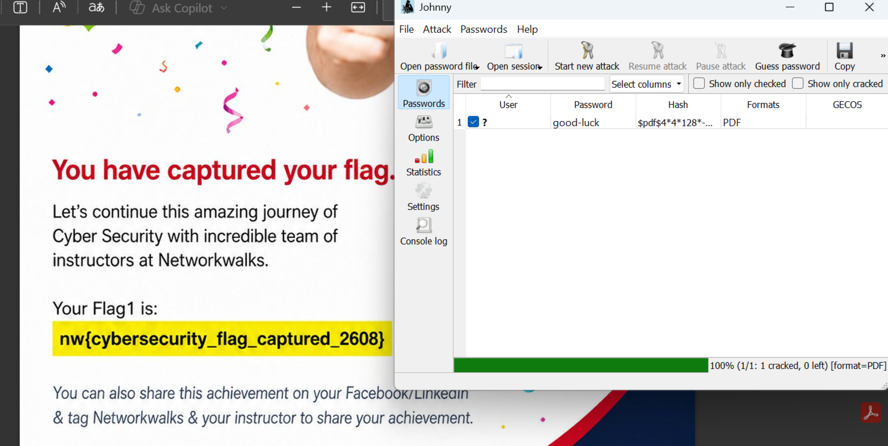
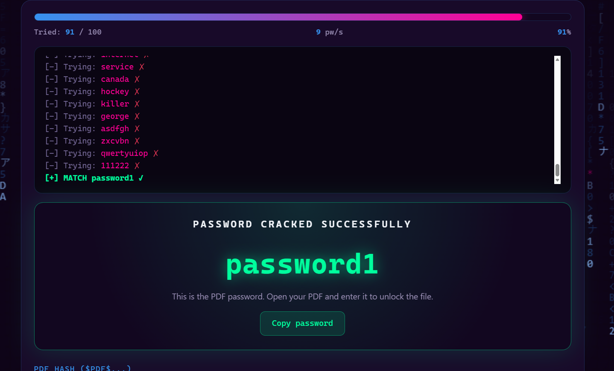
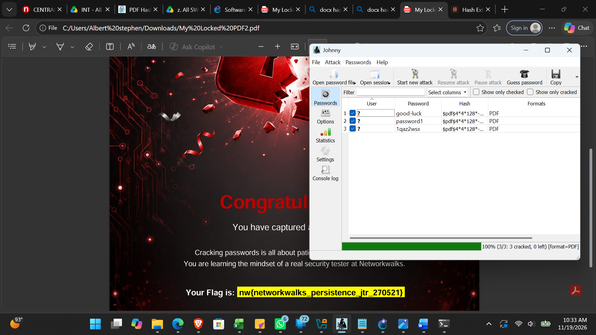

# NETWORKWALKS-ALBERT-STEPHEN-B084-WK3-PM1 AND PM2-PASSOWRD RECOVERY WITH JTR AND NW FREE TOOLS

Password Recovery with John the Ripper (JTR) and NetworkWalks Free Tools is a hands-on cybersecurity training topic focused on extracting cryptographic hashes from password-protected files (such as locked PDFs) and recovering the original plaintext passwords to audit password strength.

Password Cracking - Project Modules PM1 & PM2

## Objective
Recover the password of a protected PDF file `My Locked PDF1.pdf` using two different methods, 
- John the Ripper + Johnny GUI

- NetworkWalks Hash Calculator + NetworkWalks Password Cracker.

to understand how password cracking works and why strong passwords matter.

## Target File
- File: `My Locked PDF1.pdf`
- Cracked Password: `password1`

## Method 1: Project Module 1 - John the Ripper + Johnny GUI

**Tools:** John the Ripper (John) + Johnny GUI on Windows

**What I Did:**
1. Downloaded and installed John the Ripper and Johnny GUI
2. Uploaded the locked PDF to PDF Hash Extractor to get its hash
3. Saved the hash as `hash1.txt`
4. Opened `hash1.txt` in Johnny and started a new attack
5. Recovered the password and used it to open the PDF
  
  ## LINKS TO THE TOOLS
 - John Ripper: https://www.openwall.com/john/
 - Johnny GUI: https://openwall.info/wiki/john/johnny
 - Hash Exractor: https://www.onlinehashcrack.com/tools-pdf-hash-extractor.php
 - Hash Exrator Alternative: https://www.hashextractor.com/en#main-content

**Result:**
- Hash File: `hash1.txt`
- Cracked Password: `password1`
- Status: PDF successfully opened
# prove

## Method 2: Project Module 2 - NetworkWalks Tools (No Install)

**Tools:** NetworkWalks Hash Calculator + NetworkWalks Password Cracker - in browser only

**What is Hashing?**
Hashing is one-way. It scrambles a password into a unique value like `$pdf$...`
You cannot reverse it directly, you have to try passwords until one matches the hash.

**STEP TAKEN:**
1. Downloaded `My Locked PDF1.pdf` from the lab page
2. Uploaded it to Hash Calculator - networkwalks.com/hash-calculator/
3. Got the hash starting with `$pdf$...`
4. Copied the full hash
5. Pasted the hash into Password Cracker - networkwalks.com/password-cracker/
6. Started the attack and waited
7. Got the cracked password and opened the PDF

**Result:**
- Hash: `$pdf$...` [from Hash Calculator]
- Cracked Password: `password1`
- Status: PDF successfully opened

## Key Learning
A simple password like `password1` can be cracked very fast.
A simple 8-character lowercase password can be cracked in minutes, while a strong 12-character mixed password can take many years.
Always use long, strong, unique passwords.

## Files in This Repo
- `hash1.txt` - Hash from PM1
- `My Locked PDF1.pdf`
- `My Locked PDF2.pdf`
- `My Locked PDF3.pdf` 
- Locked PDF file
- Screenshots 
- Hash Calculator, Password Cracker, Johnny cracked password, Opened PDF

## Overall Results Status

- `PDF1` cracked ✅ Password =`good-luck`
- `PDF2` cracked ✅ Password =`password1`
- `PDF3` cracked ✅ Password =`1qaz2wsx`

## Skills
Password Cracking, Hashing, John the Ripper, Johnny GUI, Hash Calculator, Ethical Hacking Documentation

## Author
ALBERT STEPHEN
Lindkdin: www.linkedin.com/in/albert-stephen-2k26

